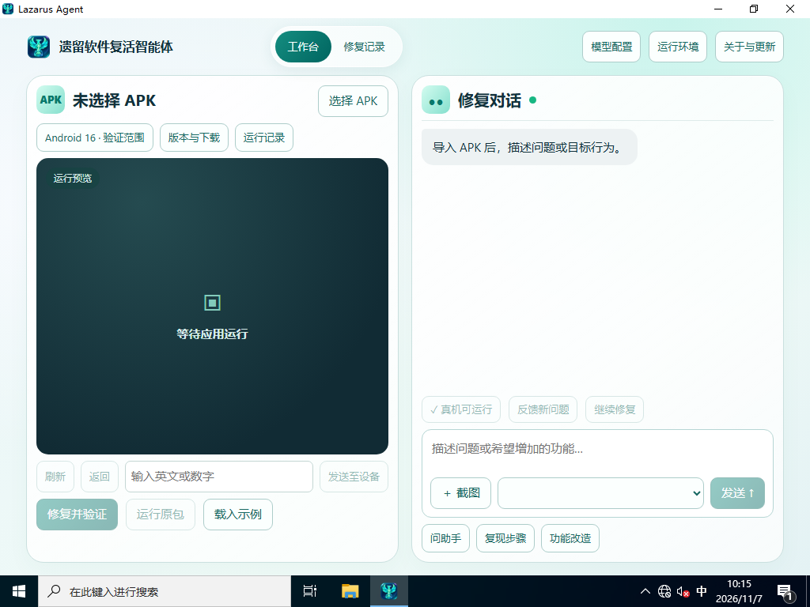

# v0.6.30 隔离 Windows 复核

在此前从空磁盘安装的 Windows Server 2022 Standard 来宾中，使用交付目录的同一 EXE 和功能验收专项 ZIP。来宾无活动物理网卡，PATH 中未发现 Git、Python、Java 或 ADB。EXE 自检退出 0，14 个登记文件和两份样本输入均通过校验，分别固定 10 步正例与 2 步矛盾断言。[核验回执](0.6.30-isolated-desktop.json)

此前 Tools 未就绪的尝试在传入材料前结束。本次 Tools 恢复后，交互运行返回用户未登录。使用专用测试账号的一次性自动登录进入桌面，正式脚本清除了自动登录密码及启用状态，随后删除含测试密码的临时脚本。专用来宾测试结束后正常关闭。

第一次截图只看到原生窗口白屏，记录为窗口打开。后续改为等待 UI Automation 识别“选择 APK”和“模型配置”等实际控件，再截图核对工作台。页面最终渲染完整，控件树包含工作台、修复记录、修复对话及环境配置，服务脚本包含新版功能验收文案。白屏观察发生在页面控件出现之前。

本次覆盖 EXE 自检、文件与输入身份以及原生页面渲染。Android 设备步骤由宿主机专用模拟器完成，同版 42 轮复跑及演示见[同版交付](0.6.30-review-final.md)。首次组件下载的独立 Windows 回执对应 v0.6.29。
